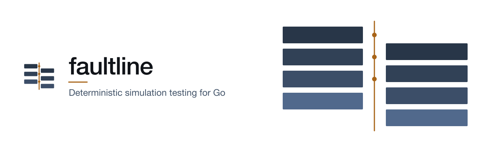

[](https://github.com/hmdsefi/faultline/actions/workflows/ci.yml?query=branch%3Amain)
[](https://github.com/hmdsefi/faultline/actions/workflows/ci.yml?query=branch%3Amain)
[](https://coderabbit.ai)
[](https://pkg.go.dev/github.com/hmdsefi/faultline)
[](https://github.com/sponsors/hmdsefi)
[](https://github.com/hmdsefi/faultline)

<p align="center">
  <picture>
    <source media="(prefers-color-scheme: dark)" srcset=".github/assets/readme-dark.svg">
    
  </picture>
</p>

<p align="center">
  Find the bugs in your distributed system before production does.
</p>

<p align="center">
  
  <br>
  <sub>The etcd/raft harness with a bug switched on: <code>go test</code> fails a seed, the timeline page
  shows the crash, and the replay command fails the same way. Without the bug switch, 40,000 seeds
  passed.</sub>
</p>

faultline is deterministic simulation testing (DST) for Go. It lets an AI coding agent test a
distributed Go system inside `go test`. It finds the bugs that make distributed tests flaky. They
appear only when messages are delayed or dropped, the network partitions, nodes crash or an fsync
fails. The system runs in virtual time on a simulated network and disk, where faultline injects
those faults. Every random choice comes from one seed, so a failing seed is a reproducible bug
report. The code under test can be ordinary Go code that starts goroutines, serves `net/http` or gRPC
and writes files, in [goroutine mode](docs/guides/goroutine-mode.md). Built through the
`faultline-toolexec` wrapper, such code replays the identical run from a failing seed. Code written
as callbacks on faultline's [node API](docs/architecture.md#the-node-api), such as the included
etcd/raft harness, replays exactly without it.

An agent that changes distributed code gets:

- retries, timeouts and crash recovery tested under faults, with message delays of 1 to 5 ms by
  default that can reorder messages on a link;
- a check of the fix: the seed that failed passes after the change, and fails again if the change
  is reverted;
- a regression test: the failing seed, pinned in a test of its own;
- invariants as code: Go functions that faultline runs after every event.

From a failing seed to a pinned regression test, every step except the fix itself is a command to
run or a file to read. People follow the same steps by hand. To start, give your agent [Use
faultline with an AI coding agent](docs/ai-agents.md). It walks through the loop and ends with a
block for the agent's `AGENTS.md` or `CLAUDE.md`. To learn faultline by hand, build the following
example step by step in [Get started](docs/getting-started.md).

<h3 align="center">⭐ If faultline is useful to you, a star on GitHub helps other Go developers find it.</h3>

## Claude Code plugin

The faultline plugin for Claude Code turns the agent guide into a skill, an agent and two commands.
Add its marketplace and install it from a Claude Code session:

```text
/plugin marketplace add hmdsefi/faultline
/plugin install faultline@faultline
```

The skill loads when a distributed Go test is flaky or a faultline test fails, the agent summarizes
a failing seed's artifact directory, and `/faultline:replay` and `/faultline:pin` replay a seed and pin it in a test. [Use
faultline with an AI coding agent](docs/ai-agents.md#claude-code-plugin) describes each part and how
to update the plugin.

## Who it is for

faultline is for Go teams, and their agents, that build a distributed system: a consensus or
replication library, a database, a queue, a controller. A service written as ordinary Go code runs
as a process in goroutine mode, once it takes its listener, dialer and filesystem as values. Code on
the node API consists of boot functions, message handlers and timers, and the etcd/raft harness
ports one real system to that API. faultline is the wrong tool when:

- Your code calls `net.Dial`, `net.Listen` or `os.Open` directly and cannot take them as values.
  faultline simulates only the network and the disk it hands to a process.
- You want to test the deployed system, or inject faults into production as chaos engineering tools
  do. faultline simulates the machines, the network and the disks inside one test process.
- You want performance numbers. Computation takes zero virtual time.

[Limitations and FAQ](docs/faq.md) lists what faultline does not do, and how it relates to
FoundationDB's simulation testing, TigerBeetle's VOPR, Antithesis, Jepsen and `testing/synctest`.

## Example

The following test from the tutorial runs a key-value server `n1` and a client `c1` for 10 seconds
of virtual time. It crashes the server about once a second and checks after every event that no
acknowledged put is lost:

```go
var kvOptions = faultline.Options{Seeds: 50, Duration: 10 * time.Second}

func TestKV(t *testing.T) { faultline.Run(t, kvOptions, kvWorld) }

func kvWorld(w *faultline.World) {
	s := &kv.Server{W: w}
	n1 := w.AddServer("n1", s.Boot)
	if err := w.Disk.Volume(n1).WriteFileDurable("/wal", nil); err != nil {
		w.T().Fatal(err)
	}
	c := &kv.Client{W: w, Server: n1.ID(), Puts: 200}
	w.AddClient("c1", c.Boot)

	w.Plan(&fault.Random{MaxDown: 1, Rules: []fault.Rule{{
		Kind: fault.KindCrash, Every: time.Second,
		MinFor: 10 * time.Millisecond, MaxFor: 500 * time.Millisecond,
	}}})
	w.Invariant("acked puts survive", func() error { return c.Lost(s, n1) })
	w.Final("every put acked", c.Done)
}
```

The tutorial builds `kv.Server` and `kv.Client` on the node API. The server's message handler has a
bug on purpose. It appends each put to the log and acknowledges it at once, while a timer syncs the
log only every 5 ms:

```go
s.W.Net.Handle(n, func(from kernel.NodeID, msg any) {
	p := msg.(Put)
	if _, err := wal.Append([]byte(p.Key + "=" + p.Value + "\n")); err != nil {
		return // no ack: the client retries
	}
	s.Data[p.Key] = p.Value
	s.W.Net.Send(n, from, Ack{Key: p.Key})
})
```

`go test` finds the bug:

```text
--- FAIL: TestKV (0.04s)
    kv_test.go:14: faultline: running 50 seeds from base 0x75c66bf05fc438d4 (test name)
    --- FAIL: TestKV/seed=0x287372ab06f1482e (0.04s)
        faultline: invariant "acked puts survive" violated at t=5.873034010s (event 1455)
          k169=v169 was acknowledged, but n1 holds ""
        replay:    FAULTLINE_SEED=0x287372ab06f1482e go test -v -run '^TestKV$' example.com/kv
        artifacts: /tmp/faultline-501/example.com_kv/TestKV/287372ab06f1482e/
    kv_test.go:14: faultline: stopping after failing seed 0x287372ab06f1482e; 49 of 50 seeds not run (set Options.KeepGoing to run all)
FAIL
FAIL	example.com/kv	0.896s
FAIL
```

The seeds come from the test name, so every machine runs the same ones. The replay command runs the
failing seed again and gets the identical run: the same check fails at the same virtual time and
event number.

The artifact directory holds the report, the trace, a text timeline, the fault schedule, the client
history and `timeline.html`. Read backward from the failure, and the timeline shows the server
sending the acknowledgment for `k169` and crashing 0.3 ms later, before its next sync:


## Goroutine code

In goroutine mode, a process is ordinary Go code that gets a simulated network in `p.Net` and the
node's simulated disk in `p.FS`. The following process serves an HTTP key-value store, `kv.Server`,
whose log lives on `p.FS`:

```go
w.AddProcess("kv", func(ctx context.Context, p *faultline.Process) error {
	s, err := kv.Open(p.FS)
	if err != nil {
		return err
	}
	ln, err := p.Net.Listen("tcp", ":8080")
	if err != nil {
		return err
	}
	srv := &http.Server{Handler: s}
	go func() { <-ctx.Done(); srv.Close() }()
	if err := srv.Serve(ln); !errors.Is(err, http.ErrServerClosed) {
		return err
	}
	return nil
})
```

A client process reaches it at `http://kv:8080/` through `netsim.HTTPClient(p.Net)`. Each run
happens inside a `testing/synctest` bubble, so `time.Sleep` and timers follow virtual time.

faultline crashes and restarts the process like any node: the context is cancelled, connections
reset, unsynced writes may be lost, and the process function runs again. In [Test goroutine
code](docs/guides/goroutine-mode.md), which builds this test, a store without a `SyncDir` call loses
54 acknowledged writes on one seed, and the timeline shows the crash dropping the log file's
directory entry.

Without help, the Go runtime decides goroutine order, `select` choices and map order, so a
goroutine-mode seed replays on a best-effort basis, and faultline's determinism check reports any
difference it sees. Built through the `faultline-toolexec` wrapper, which rewrites your packages
so that these choices come from the seed, the same seed replays exactly. [Replay goroutine code
exactly](docs/guides/exact-replay.md) sets it up.

## etcd/raft

`harness/etcdraft` runs clusters of [etcd/raft](https://github.com/etcd-io/raft) v3.7.0 inside
faultline, with checks for raft's safety properties after every event. One call, `etcdraft.Test`,
runs a whole test. It tests the raft library with the settings you choose, such as `PreVote` and
`CheckQuorum`. It does not test your application: the state machine on top of raft is the
harness's own key-value store. The harness's code is also a complete port of a real library to the
node API.

On an Apple M4 Max, one seed of a three-server cluster, 60 seconds of virtual time under the
default faults, took 68 ms on average. faultline ran 40,000 seeds of the harness, and no seed
failed. Five bug switches break the harness on purpose, and the checks caught each one on the first
seed. [Test etcd/raft with the harness](docs/guides/etcd-raft.md) shows how to write such a test,
and gives the configurations and timings of those runs.

## Install

faultline needs Go 1.26 or newer. The first command adds faultline to your module. The second adds
the etcd/raft harness, and the third gRPC support for goroutine mode. The fourth installs the
`faultline` command, which re-renders an artifact directory; your tests do not need it.

```sh
go get github.com/hmdsefi/faultline
go get github.com/hmdsefi/faultline/harness/etcdraft
go get github.com/hmdsefi/faultline/shims/grpcsim
go install github.com/hmdsefi/faultline/cmd/faultline@latest
```

For exact replay of goroutine code, add the `faultline-toolexec` wrapper to your module as a tool,
install it, prepare it for your Go toolchain, and build the tests through it:

```sh
go get -tool github.com/hmdsefi/faultline/runner/toolexec/cmd/faultline-toolexec
go install github.com/hmdsefi/faultline/runner/toolexec/cmd/faultline-toolexec
faultline-toolexec prepare
go test -toolexec=faultline-toolexec ./...
```

The root module depends only on the standard library and
[gograph](https://github.com/hmdsefi/gograph), which it uses for the network topology, the partition
and quorum queries, and the diagram of a failing run. Its packages `shims/netsim` and `shims/fsx`
give processes the simulated network and disk. The harness, gRPC support and the wrapper are
modules of their own, so etcd/raft, gRPC and protobuf stay out of your module unless you add them.

## Status

v0.2.0, early: the API may change before v1.0; artifact formats are versioned. The
[roadmap](https://github.com/hmdsefi/faultline/issues/167) lists what the later phases add.

## Documentation and help

Start with the index, or go to the page you need:

- [The documentation index](docs/README.md): the tutorial, guides, reference and concept pages.
- [The Go API on pkg.go.dev](https://pkg.go.dev/github.com/hmdsefi/faultline).
- [CONTRIBUTING](.github/CONTRIBUTING.md) and [SECURITY](.github/SECURITY.md): how to send a change,
  and how to report a vulnerability privately.

## License

faultline is licensed under the [Mozilla Public License 2.0](LICENSE). You can use it in any
project, including closed-source ones. If you change faultline's own files and distribute them,
those files stay under the MPL 2.0. You must make their source available and keep the copyright
and license notices.
