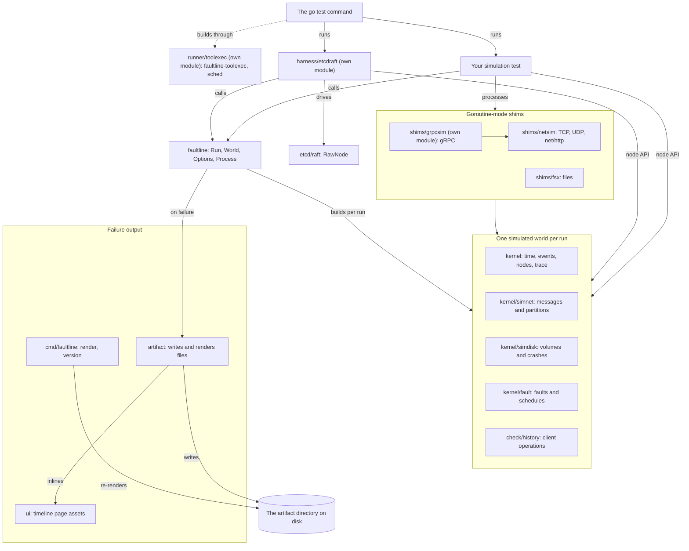

# Architecture

faultline is a Go library built around one simulator, with two ways to run the code under test:
callbacks on the node API, and ordinary goroutine code. Around it sit two commands and nested
modules for etcd/raft, gRPC and exact replay. This page shows what each package owns, how one seed
moves through them, and why the design looks the way it does.

## The node API

The node API is the set of Go types that code under test calls in place of the operating system.
It is not a server, a network protocol or a command-line tool. It is an ordinary Go API in the
packages `kernel`, `kernel/simnet` and `kernel/simdisk`, and your test imports it like any other
library. Everything runs inside the `go test` process: the simulation opens no port, starts no
process and uses no real file. The only real files are the artifact directories faultline writes for
you to debug with.

A *node* is one simulated machine, held as a `*kernel.Node` value. It is not an operating system
process and not a goroutine. Code on the node API has three parts:

- A *boot function* of type `kernel.BootFunc`, passed to `w.AddServer` or `w.AddClient`, where `w`
  is the `*faultline.World` your test builds. faultline calls the boot function when the node first
  starts and again after every restart.
- The callbacks that the boot function installs: a message handler with `w.Net.Handle`, and timers
  with `n.After`.
- The calls those callbacks make: `w.Net.Send` for messages, `w.Disk.Volume(n)` for files, `n.Now`
  for the node's clock and `n.Rand` for random numbers.

Each of these takes the place of a standard library call. `w.Net.Send` replaces a socket write, and
the message is a Go value that the simulated network hands to the receiver's handler. The volume's
`Create` and `Open`, and the file's `Append` and `Sync`, replace `os.File`. `n.After` replaces
`time.AfterFunc` and measures virtual time on the node's clock. The kernel runs one callback at a
time on one goroutine, so a callback must return without blocking and must not start goroutines. A
blocking callback stalls the whole simulation, and a goroutine runs outside the seeded event queue.
The code returns, and a message or a timer calls it again. [Get started](getting-started.md) builds a key-value
server on this API, and [How faultline works](how-it-works.md#nodes) describes what a crash does to
a node.

A *harness* is code that ports a real system to the node API. `harness/etcdraft` does that for
etcd/raft, so you can test raft without writing the port yourself. etcd/raft came first because its
`RawNode` holds the raft algorithm alone. It starts no goroutines and does no I/O, so the harness
supplies the messages, the write-ahead log and the timers from the node API.

## Processes in goroutine mode

Goroutine mode runs code that was not written for the node API. A *process* is a node whose code is a
function `func(ctx context.Context, p *faultline.Process) error`, which runs on its own goroutine and
may start more. It gets the network and the disk as values: `p.Net`, a host on the simulated
network with TCP and UDP sockets that implement the `net` interfaces, and `p.FS`, the node's volume
behind an interface modelled on package `os`. Code that takes its listener, dialer and filesystem as
values runs unchanged, with `net/http` and gRPC on top.

Each run happens inside a `testing/synctest` bubble. A driver goroutine runs the kernel's events, one
at a time, only when every process goroutine is durably blocked. [How faultline
works](how-it-works.md#goroutine-mode) describes what a process sees, and [Test goroutine
code](guides/goroutine-mode.md) shows how to write one.

## The packages

A test calls `faultline.Run`, which builds a fresh simulated world for every run from the kernel and
the packages around it. A failing run goes to package `artifact`, which writes the files you debug
with.

The packages do these jobs:

- `faultline`, the module root, is the test entry point: `Run`, `RunSeeds`, `Options`, `World`
  and, for goroutine mode, `Process`. It reads the `FAULTLINE_*` environment variables, derives the
  seed list and runs each seed as a subtest. It runs the checks, classifies failures, runs failing
  seeds a second time and prints the report. In goroutine mode it also owns the driver, the stall
  watchdog and the leak report.
- `kernel` is the discrete-event simulator. It owns virtual time, the event queue and its seeded
  tie-break, the named random streams, and nodes with their incarnations, crashes, pauses and
  clocks. It also keeps the trace and its running hash. It starts no goroutines and imports only the
  standard library.
- `kernel/simnet` is the network. It models links with latency, jitter, loss, duplication and FIFO
  order. It keeps the topology as a directed graph in gograph, which answers questions such as which
  nodes still have direct links to a quorum.
- `kernel/simdisk` is the disk: one volume per node, unsynced writes and metadata, crash models,
  failed syncs, capacity and corruption.
- `kernel/fault` treats faults as data. It holds fault events, schedules and their JSON format, the
  injector that applies and records faults, and the planners `Random`, `Script` and `None`.
- `check/history` records client operations, and reads and writes `history.jsonl`.
- `artifact` reads and writes the artifact directory. It renders `timeline.txt`, `hb.mmd` and
  `timeline.html` from the trace. Its functions depend only on their inputs: no clock, no
  randomness, no environment.
- `ui` embeds the web assets that `timeline.html` inlines, and imports only the standard library.
- `cmd/faultline` is the `faultline` command. `faultline render <dir>` regenerates the three
  rendered files of an artifact directory, and `faultline version` prints the version.
- `shims/netsim` gives each process a host on the simulated network: TCP connections and
  listeners, UDP sockets, name resolution for node names, and an `http.Transport` that dials
  through the host.
- `shims/fsx` defines `fsx.FS`, a filesystem interface modelled on package `os`, with `fsx.OS` on a
  real directory and `fsx.Sim` on a simulated volume.
- `shims/grpcsim` is a separate Go module. It connects gRPC clients and servers to `netsim`.
- `runner/toolexec` is a separate Go module, the toolexec backend. Its command
  `faultline-toolexec` rewrites the packages of a test binary at build time, and its package
  `sched` is the scheduler the rewritten code calls.
- `harness/etcdraft` is a separate Go module. It runs clusters of `go.etcd.io/raft/v3` v3.7.0 inside
  faultline, with a write-ahead log on the simulated disk and a key-value state machine. It adds
  clients recorded in the history, fault presets, and safety and liveness checks. Most tests call
  `etcdraft.Test`.

Imports go in one direction. `simnet` and `simdisk` build on `kernel`, and `fault` builds on those
three. The shims build on the kernel packages, and the root package on the shims. Nothing in the
simulation imports `faultline` or `artifact`. A test in faultline's suite checks these import rules.

## How one seed runs

Each seed is a subtest, and each subtest runs one or more attempts of the same run. An attempt
builds a new kernel, network, disk and planner state, and calls your world function again. The
attempts of a seed share only the seed and the options, which is why the world function builds all
of its state from `w`.

By default the first attempt keeps only the trace hash, so a passing seed costs little memory. If
the first attempt fails, faultline runs a second attempt that keeps every record. The second trace
hash must equal the first. faultline then writes the artifact directory from the second attempt and
prints the report.

With `FAULTLINE_CHECK_DETERMINISM=1`, a passing seed also gets a second attempt, and a different
trace hash fails the seed. When two attempts differ, faultline runs the seed with full traces until
it has two traces to compare. It reports the first record where they differ, and a list of common
causes.

In goroutine mode, each attempt runs inside its own `testing/synctest` bubble. The driver goroutine
calls the world function, starts the processes, and then loops: it waits until every other
goroutine in the bubble is durably blocked, runs the requests and the next event, and runs the
invariants. When the run ends, it cancels the processes' contexts and gives them the drain time to
return. With the toolexec backend, the driver also releases one goroutine waiting at a scheduling
point per pass, chosen from the seed, before it lets virtual time move.

## Design choices

The first two choices follow from one requirement: a seed gives the same run on every supported
platform. The other two keep faultline out of the way of a module's other tests and dependencies.

### One thread, discrete events

The kernel runs every callback on one goroutine, one at a time, in an order fixed by virtual time
and the seed. A simulator with real goroutines would need the Go scheduler to make the same choices
in every run, and the Go scheduler takes no seed. With one thread and an event queue, the queue is
the only source of ordering, and the queue is seeded. The cost is that code under test is written as
callbacks.

### A driver goroutine for goroutine code

Goroutine mode keeps the single-threaded kernel and puts real goroutines around it. Only the driver
runs kernel events, and only when every process goroutine is durably blocked, so the kernel still
runs one event at a time in seeded order. A process's own network and file calls change the world
under one lock, on the process's goroutine. `testing/synctest` supplies the fake clock and tells the driver when
the bubble is idle. What a woken goroutine does before it blocks again is up to the Go runtime,
which is why goroutine-mode replay is best-effort without the next choice.

### A source rewriter for exact goroutine order

The Go runtime offers no hook to seed its scheduler, its map order or its `select` choices.
faultline compared two ways around that. One ran the test binary under WebAssembly, where the guest
is single-threaded; the other rewrote the source at build time through `go test -toolexec`. The
criteria were fixed before either was built: exact replay on every test program, slowdown, and
working on both supported Go versions, among others. The rewriter met all of them and was chosen. The rewritten
code parks at every operation that can block or wake another goroutine, and the driver releases one
parked goroutine at a time with a seeded choice. The standard library and the module cache stay
unchanged by default, and you opt a package in when your test depends on the order of its
goroutines.

### Named streams and integer decisions

Each node, link, disk and planner draws from its own random stream. A change in one part of a run
changes the draws of the streams that part uses. Every other stream still produces the same
sequence of numbers. With one shared generator, a single extra draw would shift every later random
decision in the run.

Random decisions use integers: probabilities in parts per million and durations in nanoseconds. The
[Go specification](https://go.dev/ref/spec#Floating_point_operators) lets a compiler fuse a multiply
and an add into one instruction, so a float result can differ between amd64 and arm64. Integers give
the same answer on both, and a seed gives the same run on both.

### Environment variables, not flags

faultline reads its settings from `FAULTLINE_*` environment variables. `go test ./...` passes a test
flag to every package's test binary, and a binary that does not define the flag fails. An
environment variable reaches every test binary, and the ones that do not use faultline ignore it.

### A small dependency footprint

The root module depends on the standard library and [gograph](https://github.com/hmdsefi/gograph)
only. Anything heavier lives in a nested module with its own `go.mod`. `harness/etcdraft` requires
etcd/raft and protobuf, and `shims/grpcsim` requires gRPC. A project that does not import them does
not depend on them. `runner/toolexec` is a module of its own too, and requires only faultline. The
root module never imports the nested modules.

## How faultline checks its own determinism

faultline holds its own simulation packages to the rules it asks of your code, and its test suite
checks them:

- A lint test parses the simulation packages. It rejects `go` statements, `select`, and functions
  that run code on another goroutine, such as `runtime.SetFinalizer`. It rejects ranging over a map
  without sorting, and functions that call code in map order, such as `maps.DeleteFunc`. It also
  rejects wall-clock time, package-level random functions, `crypto/rand`, and environment reads such
  as `os.TempDir`. Floating point in decision code and files limited to one operating system or CPU
  fail it too.
- CI runs the whole suite with `FAULTLINE_CHECK_DETERMINISM=1`, so every passing seed of every test
  runs twice and must give the same trace hash.
- Golden trace hashes pin the exact runs of a set of small scenarios. CI computes them on Linux on
  amd64 and macOS on arm64, with Go 1.26 and Go 1.27, and fails when any two disagree.
- The toolexec backend's tests build test programs through the wrapper on the same platforms and Go
  versions, and check that every seed gives the same trace hash and the same goroutine order twice.

## Next steps

- [How faultline works](how-it-works.md): time, the scheduler, the network, the disk, faults and
  replay.
- [Use faultline with an AI coding agent](ai-agents.md): the loop from a failing seed to a pinned
  regression test.
